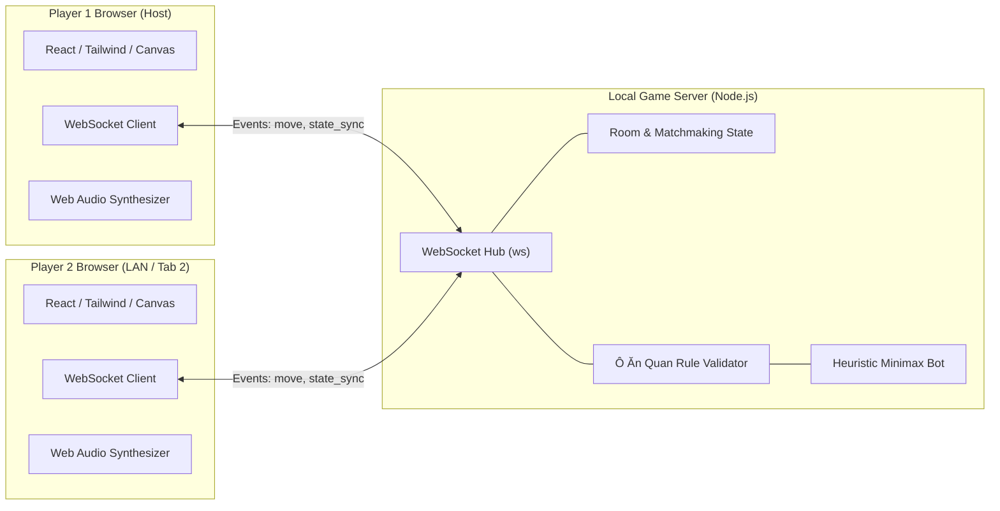
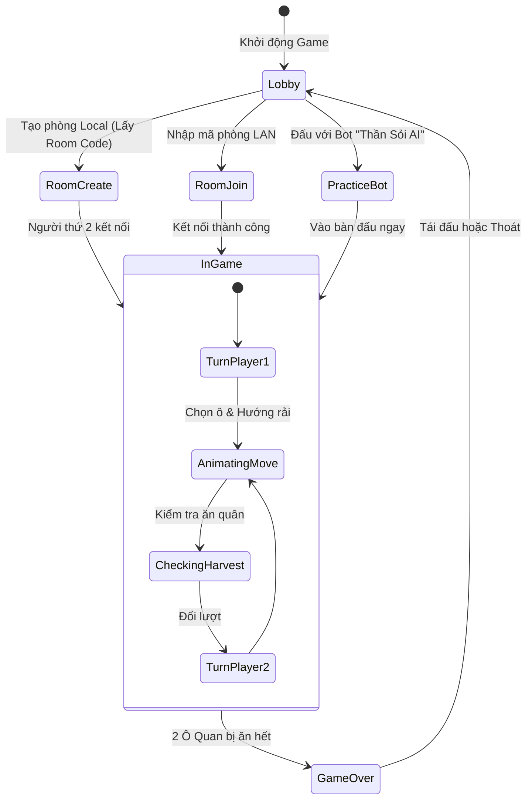

# Product Requirements Document (PRD)
## Ô Ăn Quan — Cyber Folk Edition (Local WebSocket)

---

### 1. Giới thiệu tổng quan (Executive Summary)

**Ô Ăn Quan — Cyber Folk** là bản tái hiện kỹ thuật số của trò chơi dân gian kinh điển Việt Nam, kết hợp tinh thần thủ công truyền thống với ngôn ngữ thiết kế kỹ thuật số đương đại (Digital Craftsmanship). 

Trò chơi chạy hoàn toàn trên môi trường **Local (100% Offline/LAN)**, hỗ trợ 2 người chơi thi đấu thời gian thực qua **WebSocket**, kèm chế độ đấu Bot AI thuật toán. Dự án hướng tới cộng đồng GDG (Google Developer Groups) với mã nguồn sạch, trực quan, thẩm mỹ tinh tế và dễ triển khai chỉ bằng 1 câu lệnh.

---

### 2. Định hướng Thiết kế & Nghệ thuật (Design Philosophy)

> [!IMPORTANT]
> **Tiêu chí cốt lõi:** Tránh bẫy "Cyberpunk lòe loẹt" (lạm dụng đèn neon tím/hồng chói mắt phong cách AI tạo ảnh rẻ tiền). Thay vào đó, áp dụng phong cách **"Neo-Heritage / Obsidian Craft"**: Sang trọng, tối giản, lấy cảm hứng từ đá cuội sẫm màu, ngọc bích và giao diện số chính xác (Data-precise interface).

#### 2.1 Bảng màu (Color Palette)
- **Nền chủ đạo (Background):** Obsidian Dark (`#0B0F14`, `#121820`, `#1A232E`) — Tối sâu nhưng dịu mắt, gợi liên tưởng đến mặt đá mài hoặc gỗ mun đánh bóng.
- **Vật liệu bàn cờ (Board Surface):** Slate Glass mờ (`rgba(26, 36, 48, 0.75)`) với viền hairline tinh xảo (`1px solid rgba(255, 255, 255, 0.08)`).
- **Màu điểm nhấn (Accents):**
  - **Ngọc Bích Mờ (Jade Tint - `#10B981` / `#059669`):** Dành cho Quân/Sỏi Người chơi 1, trạng thái sẵn sàng, nước đi hợp lệ.
  - **Hổ Phách Ấm (Warm Amber - `#F59E0B` / `#D97706`):** Dành cho Quân Người chơi 2 / Bot AI, thông báo chiến lược.
  - **Đá Cuội / Sỏi (Pebble Texture):** Tone xám tro ngọc (`#8E9CAE`, `#CBD5E1`) có đổ bóng mềm tạo cảm giác khối vật lý.
- **Văn bản (Typography Colors):** Trắng ngà (`#F1F5F9`) cho tiêu đề, xám bạc (`#94A3B8`) cho nội dung phụ.

#### 2.2 Typography (Kiểu chữ đề xuất)
- **Tiêu đề & Nhận diện (Display Font):**
  - Sử dụng **Space Grotesk** hoặc **Cabinet Grotesk** (Font Sans hiện đại, hình học sắc sảo nhưng không góc cạnh thô ráp, hỗ trợ tiếng Việt trọn vẹn).
- **Số liệu & Tọa độ bàn cờ (Data & Counters):**
  - **JetBrains Mono** hoặc **Geist Mono**: Giúp các con số đếm sỏi trong ô luôn thẳng cột, rõ ràng như màn hình radar chiến thuật.
- **Nội dung chung (Body Font):**
  - **Inter** hoặc system-ui: Đọc êm, trung tính, hiện đại.

#### 2.3 Hiệu ứng Âm thanh & Xúc giác (Audio & Haptics)
- Tận dụng **Web Audio API** để tổng hợp âm thanh bằng code thuần (không cần tải file audio nặng):
  - Tiếng sỏi rơi lách cách ("clack-click") đanh gọn của đá cuội gõ vào nhau.
  - Âm thanh thu hoạch điểm (ăn quân) trầm ấm dạng mộc cầm (marimba/woodblock synth).
  - Hiệu ứng rải quân (mỗi ô nhận sỏi có độ trễ 180ms kèm âm thanh tăng nhẹ cao độ).

---

### 3. Kiến trúc Hệ thống & Kỹ thuật (Technical Architecture)

#### 3.1 Stack công nghệ
- **Frontend:** React 19 / Vite + Tailwind CSS + Lucide Icons + Canvas/Framer-Motion (nhẹ, build nhanh, hot-reload tức thì).
- **Backend WebSocket:** Node.js với thư viện `ws` siêu nhẹ (không cồng kềnh, độ trễ < 5ms trên mạng nội bộ).
- **Phân phối:** Đóng gói trong cùng 1 repository:
  - 1 lệnh `npm run dev` chạy cả Client lẫn WebSocket Server (hoặc mở cổng LAN để đồng nghiệp vào chơi chung).

---

### 4. Chi tiết Luật chơi & Quy tắc Vận hành (Game Rules Engine)

1. **Cấu trúc bàn cờ:**
   - **10 Ô Dân:** 2 hàng, mỗi hàng 5 ô. Mỗi ô dân khởi đầu có 5 viên sỏi nhỏ.
   - **2 Ô Quan:** 2 đầu bán nguyệt. Mỗi ô quan có 1 viên Quan lớn (tương đương 10 điểm) hoặc 10 sỏi nhỏ.
   - Tổng điểm trên bàn cờ: `(10 ô x 5) + (2 quan x 10) = 70 điểm`.
2. **Lượt đi:**
   - Người chơi chỉ được chọn các ô dân thuộc hàng của mình có chứa từ 1 viên sỏi trở lên.
   - Chọn hướng rải: **Sang Trái (Ngược chiều kim đồng hồ)** hoặc **Sang Phải (Cùng chiều kim đồng hồ)**.
   - Hệ thống tự động diễn hoạt quá trình rải sỏi từng viên một cách trực quan.
3. **Quy tắc nối nước & Ăn quân:**
   - Nếu viên sỏi cuối cùng rơi vào 1 ô dân mà ô tiếp theo vẫn có sỏi -> Tự động bốc tiếp rải tiếp.
   - Nếu ô tiếp theo là **ô trống**, và ô kế sau ô trống đó **có sỏi** -> Người chơi **ĂN** toàn bộ sỏi ở ô kế đó.
   - Nếu tiếp tục có các khoảng cách trống - có sỏi xen kẽ -> Ăn liên hoàn.
   - Nếu sỏi cuối rơi vào ô trước ô Quan, hoặc 2 ô trống liên tiếp -> Kết thúc lượt.
4. **Vét sỏi / Mượn sỏi (Khi hàng hết quân):**
   - Đến lượt mà 5 ô dân của mình đều trống, người chơi phải lấy 5 điểm từ quỹ của mình rải đều vào 5 ô dân của mình để tiếp tục chơi.
5. **Điều kiện kết thúc:**
   - Khi cả 2 ô Quan đều đã bị ăn sạch.
   - Các sỏi dân còn sót lại trên hàng nào thuộc về người chơi sở hữu hàng đó. Người có tổng điểm cao nhất chiến thắng.

---

### 5. Các Màn hình & Luồng trải nghiệm (UX Flows)

#### 5.1 Lobby (Sảnh chờ)
- Tiêu đề tối giản, badge trạng thái `Local WebSocket Server: Connected`.
- 3 Lựa chọn rõ ràng:
  - **Tạo phòng (Host Match):** Sinh mã phòng 4 số ngẫu nhiên (ví dụ: `#8080`), hiển thị link LAN (ví dụ: `http://192.168.1.15:5173/?room=8080` để người bên cạnh mở điện thoại/laptop vào chơi ngay).
  - **Tham gia phòng (Join Match):** Nhập mã 4 số.
  - **Đấu tập với Bot:** Tùy chọn độ khó (Dễ / Chiến thuật gia).

#### 5.2 Màn hình Bàn cờ (In-Game Dashboard)
- **Thanh trạng thái đầu trang:**
  - Tên 2 bên + Avatar icon tối giản + Điểm số (Score Counter) phong cách Digital Counter.
  - Đèn báo hiệu lượt đi (Pulse Indicator) màu Jade hoặc Amber.
- **Bàn cờ trung tâm:**
  - Thiết kế bán nguyệt 2 đầu uốn cong mềm mại.
  - Các ô có hiệu ứng Hover viền mảnh khi đến lượt người đó.
  - Khi click vào 1 ô hợp lệ, xuất hiện 2 mũi tên định hướng (← Trái | Phải →) để người chơi bấm chọn chiều rải.
  - Số lượng sỏi hiển thị bằng số to rõ ràng + biểu tượng các viên sỏi đa giác ngẫu nhiên xếp bên trong.
- **Action Log / Tường thuật ván đấu (Bên cạnh):**
  - Lịch sử nước đi ngắn gọn dạng terminal log: `P1 rải ô #3 theo chiều kim đồng hồ -> Ăn 7 sỏi`.

---

### 6. Kế hoạch triển khai kỹ thuật (Implementation Roadmap)

| Giai đoạn | Hạng mục công việc | Output cụ thể |
|---|---|---|
| **P1: Game Core** | Thiết kế State & Luật Ô Ăn Quan | `gameRules.ts` thuần túy, unit test logic rải, nối nước, ăn liên hoàn |
| **P2: WebSocket** | Xây dựng Server Hub nội bộ | `server.js` xử lý tạo phòng, sync state, ngắt kết nối |
| **P3: UI/UX & Style** | Dựng Board React + Tailwind | Bàn cờ Obsidian Slate, hiệu ứng số, arrows chọn chiều |
| **P4: Sound & Animation** | Web Audio Synth + Rải sỏi | Âm thanh lách cách sỏi, hiệu ứng bay viên đá |
| **P5: Bot & Polish** | Thuật toán Minimax + Đóng gói | Chế độ solo với Bot, hướng dẫn chạy 1 lệnh README |
